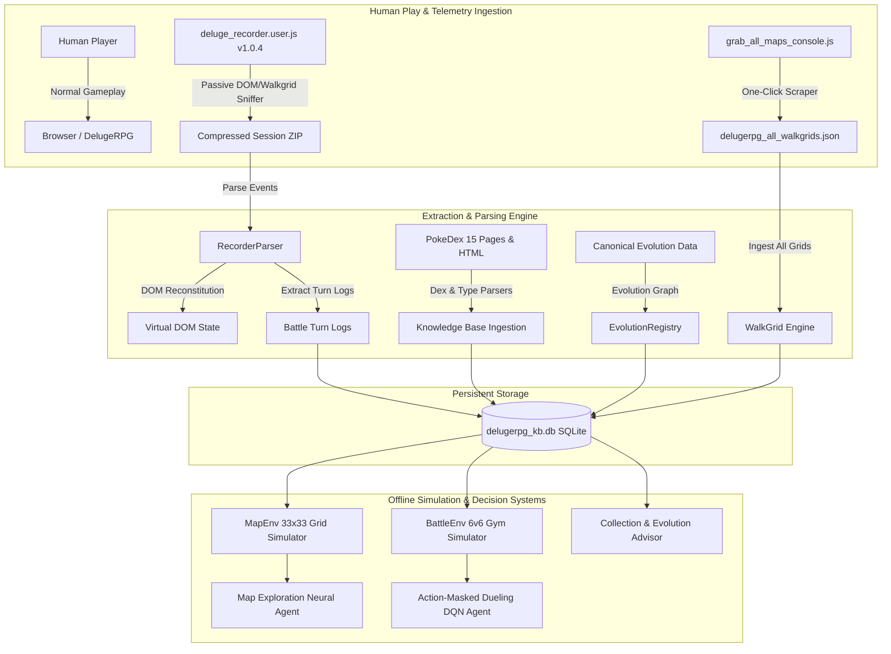

# DelugeRPG Automation, Ingestion & Simulation Architecture Guide

**Author:** Vamsi (3rd-Year Software Engineering Project)  
**System Scope:** Data Extraction Pipeline, Walkgrid & Map Graph Engine, Offline Simulators (`MapEnv`, `BattleEnv`), Evolution Dex, Collection Advisor, and Reinforcement Learning Agents  
**Operating Environment:** Offline Lenovo IdeaPad (Intel i5 U-series, CPU only, ~7.5 GB free RAM, PyTorch CPU)  

---

## 1. System Philosophy & Ethical Boundaries

This deep-learning course project adheres strictly to ethical research guidelines:
1. **100% Offline Execution:** All agent training, simulation environments, vector indexing, and evaluations run locally on the IdeaPad.
2. **Zero Live Automation / No Botting:** The Python system never connects to or executes actions against the live DelugeRPG website. Human gameplay is performed by the user; our tools only passively observe telemetry via `deluge_recorder.user.js`.
3. **Hardware-Conscious Design:** Models are strictly constrained to $\le 300\text{k}$ parameters ($< 1.5\text{MB}$ checkpoint size) using PyTorch CPU, with overall RAM footprint kept $< 1.5\text{GB}$.



---

## 2. Ingestion Pipeline: `deluge_recorder.user.js` (v1.0.4)

The session recorder passively captures page mutations, network timing, and game state changes without injecting speculative requests or interfering with gameplay.

### 2.1 The 10 Event Primitives
Every event follows Schema 1 (Array format `[type, timestamp, ...]` or Dict format `{"t": type, "ts": timestamp, "d": data}`):

| Event Code | Semantic Meaning | Data Payload Format | Engine Processing Action |
| :---: | :--- | :--- | :--- |
| **`P`** | Page Baseline Snapshot | `['P', t, url, title, bodyHtml]` | Initializes document root in BeautifulSoup; resets active page state; checks battle/team context. |
| **`+`** | Element Added | `['+', t, path, index, html]` | Parses HTML fragment; attaches nodes to parent in virtual DOM; detects battle text updates. |
| **`T`** | Text Added | `['T', t, path, text]` | Appends `NavigableString` to target element in virtual DOM. |
| **`-`** | Element Removed | `['-', t, path, desc]` | Locates target element and executes `decompose()`, pruning the virtual DOM tree. |
| **`a`** | Attribute Changed | `['a', t, path, attr, val]` | Mutates attribute value on target Tag; if `val` is null, removes attribute. |
| **`x`** | Text Node Replaced | `['x', t, path, text]` | Overwrites `.string` content of target node; extracts live HP/status changes. |
| **`c`** | User Control Action | `['c', t, tag, type, path, val, label]` | Logs user click/form input for behavioral analysis. |
| **`n`** | Network Request | `['n', t, type, path, duration]` | Tracks background AJAX latency (e.g. `/ajax/battle/`, `/ajax/map/move/update/`). |
| **`m`** | Map Change / Move | `['m', t, file, num, title]` | Emits player coordinate change; builds directed map transition graph. |
| **`g`** | Walkgrid Data | `['g', t, map_name, b64_grid]` | Decodes 2,178-byte base64 grid; registers `WalkGrid` instance to database. |

### 2.2 v1.0.4 Walkgrid Sniffing Engine
In v1.0.4, walkgrid extraction uses a 3-tier cascade to overcome userscript execution sandboxing:
1. **Tier 1 (`unsafeWindow`)**: Reads `unsafeWindow.mapWalkgrid` directly from the main page context in Tampermonkey/OrangeMonkey.
2. **Tier 2 (`window`)**: Fallback to standard window scope.
3. **Tier 3 (DOM Script Regex Sniffer)**:
   Scans all `<script>` tags in the live document using:
   ```javascript
   var match = scriptText.match(/mapWalkgrid\s*=\s*["']([^"']+)["']/);
   ```
4. **Visual Toast Feedback**: Displays an instant UI confirmation banner upon successful capture:
   `✔ Map walkgrid recorded: overworld5 (2904 chars)`

---

## 3. Walkgrid & Spatial Graph Engine (`delugerpg/parsers/walkgrid.py`)

### 3.1 Binary Walkgrid Decoding
- DelugeRPG maps are strictly $33 \times 33 = 1,089 \text{ tiles}$.
- Stored as $2,178 \text{ raw bytes}$ ($2,904 \text{ Base64 characters}$).
- Decoded into `WalkTile(x, y, walkable, is_water, raw_byte0, raw_dirmask, allowed_directions)`.
- `allowed_directions`: Dictionary mapping `n, s, w, e, nw, ne, sw, se` to boolean values based on Byte 1 `PEEP_DIRBITS`.

### 3.2 Pathfinding & Breadth-First Search (BFS)
- Evaluates shortest legal paths between any $(x_1, y_1)$ and $(x_2, y_2)$.
- Validates directional bitmasks on every hop, ensuring agents never attempt illegal movements over one-way ledges or barriers.

---

## 4. SQLite Database Architecture (`data/processed/delugerpg_kb.db`)

Managed by `DatabaseManager` (`delugerpg/db/database.py`):

1. **`pokemon_species`**:
   - `dex_no` (INTEGER), `name` (TEXT PRIMARY KEY), `type1` (TEXT), `type2` (TEXT), `is_mega` (BOOLEAN), `is_gmax` (BOOLEAN).
   - Contains all **1,107 species** (Gen 1 to 9).
2. **`user_collection`**:
   - `pokemon_name` (TEXT), `class_name` (TEXT), `owned` (BOOLEAN).
   - Tracks ownership across all 10 variant classes (Normal, Shiny, Metallic, Ghostly, Dark, Shadow, Mirage, Chrome, Negative, Retro).
   - Currently records **158 Normal species owned** on the user's account.
3. **`pokemon_evolutions`**:
   - `species_name` (TEXT PRIMARY KEY), `base_species` (TEXT), `evolution_stage` (INTEGER 1..3), `evolves_from` (TEXT), `evolves_to` (TEXT), `category` (TEXT).
   - Maps **879 canonical species** into family trees, branching evolutions, and rarity tiers (`starter`, `legendary`, `mythical`, `ultra_beast`, `paradox`, `regular`).
4. **`map_walkgrids`**:
   - `map_name` (TEXT PRIMARY KEY), `walkgrid_b64` (TEXT), `total_walkable` (INTEGER), `total_water` (INTEGER), `total_blocked` (INTEGER), `total_restricted` (INTEGER).
   - Ingests all **49 game maps** (Overworld 1–25, Pokémon Mansion 1–4, Pokémon Tower 1–3, Power Plant 1–3, Rock Cave 1–4, Snow Cave 1–4, Unown Ruins 1–2, Volcano 1–4).
   - Stores 53,361 total tiles with explicit directional masks (`PEEP_DIRBITS`), one-way jumping ledges (2,472 tiles), bridges (52 tiles), and choke ladder/stairs entry points (19 tiles).
5. **`type_effectiveness`**:
   - $18 \times 18$ matrix storing standard and inverted damage multipliers.
6. **`attacks`**:
   - 591 registered moves with base power, accuracy, type, and secondary effect data.
7. **`battle_logs`**:
   - Empirical turn-by-turn combat logs parsed from recorder sessions.

---

## 5. Offline Reinforcement Learning Simulators

### 5.1 `MapEnv` (Grid Navigation & Exploration Simulator)
Implemented in [`delugerpg/simulator/map_env.py`](file:///c:/Users/dugge/OneDrive/Documents/Projects/DELUGERPG/delugerpg/simulator/map_env.py):
- **Observation Space**: Standard Box vector (dimension 53):
  - $7 \times 7 \times 2$ surrounding local window (walkability channel and visited channel).
  - Normalized coordinates $[x/32.0, y/32.0]$.
  - Map exploration ratio $(\text{visited} / \text{total\_walkable})$.
  - Remaining steps ratio.
- **Action Space**: `Discrete(8)` corresponding to `DIR_OFFSETS`:
  - 0: `n` (-1, 0), 1: `s` (+1, 0), 2: `w` (0, -1), 3: `e` (0, +1),
  - 4: `nw` (-1, -1), 5: `ne` (-1, +1), 6: `sw` (+1, -1), 7: `se` (+1, +1).
- **Physics & Bitmask Collision**:
  Movement is validated against `walkgrid.tiles[cx][cy].allowed_directions[dir_name]`. If blocked, the agent stays in place and incurs a collision penalty.
- **Reward Signal**:
  $$R = R_{\text{step}} (-0.01) + R_{\text{unvisited\_tile}} (+0.25) + R_{\text{encounter}} (+1.0) - R_{\text{collision}} (0.2)$$
- **Action Masking**: `get_action_mask()` returns an 8-element binary vector indicating valid legal moves from the current tile.

### 5.2 `BattleEnv` (Turn-Based Gym Battle Simulator)
Implemented in [`delugerpg/simulator/battle_env.py`](file:///c:/Users/dugge/OneDrive/Documents/Projects/DELUGERPG/delugerpg/simulator/battle_env.py):
- **Team Size**: Full 6v6 party battles or 1v1 wild encounters.
- **Observation Space**: Standard 64-dimensional float vector:
  - Active Player: HP ratio ($1$), Type 1 & 2 ($2$), Class ($1$), 4 Moves (power, type, effectiveness against opponent) ($12$).
  - Active Opponent: HP ratio ($1$), Type 1 & 2 ($2$), Class ($1$).
  - Player Bench: 5 bench members $\times$ (HP ratio, Type 1, Type 2) ($15$).
  - Opponent Remaining Ratio ($1$).
  - Action Mask ($9$).
- **Action Space**: `Discrete(9)`:
  - Actions 0–3: Move 1 to 4.
  - Actions 4–8: Switch to bench party members 1 to 5.
- **Damage Formulation**:
  $$\text{Damage} = \left\lfloor \frac{\text{Level} \times \text{Power}}{50} \right\rfloor \times \text{STAB} \times \text{VariantMult} \times \text{TypeMult}$$
- **Variant Passives Implemented**:
  - `Shiny`: $+25\%$ HP ($1.25\times$).
  - `Dark`: $+25\%$ Attack ($1.25\times$).
  - `Ghostly`: Innate flinch chance.
  - `Metallic`: Status ailment immunity.
  - `Shadow`: Pierces Metallic & Ghostly immunities.
  - `Negative`: Inverts type effectiveness ($2.0\times \to 0.5\times$, $0.5\times \to 2.0\times$, $0.0\times \to 2.0\times$).
- **Action Masking**: Filters out empty move slots, fainted bench members, or switching to the already active Pokémon.

---

## 6. Collection & Evolution Advisor Engine (`delugerpg/models/advisor.py`)

The advisor operates in **$O(1)$ constant time** using in-memory hash sets loaded from SQLite:

### 6.1 Wild Encounter Decision Logic (`evaluate_encounter`)
When roaming in `MapEnv` or live play, incoming encounters are scored:
1. **Unowned Normal Species**:
   $$\text{Decision} = \mathbf{CAPTURE} \quad (\text{Priority: HIGH}) \implies \text{"Missing from your Normal Pokédex!"}$$
2. **Owned Normal Species with Missing Family Evolutions**:
   $$\text{Decision} = \mathbf{CAPTURE} \quad (\text{Priority: MEDIUM}) \implies \text{"You own Ekans, but Arbok is missing. Capture to evolve!"}$$
3. **Fully Completed Evolution Family**:
   $$\text{Decision} = \mathbf{SKIP} \quad (\text{Priority: NONE}) \implies \text{"Family complete in Normal class. Save Pokéballs."}$$
4. **Variant Species (Shiny, Dark, etc.)**:
   Identifies whether the variant is already owned or new.

### 6.2 Evolution To-Do List Generator (`get_evolution_recommendations`)
Scans owned species and generates an actionable evolution queue. Currently identifies **28 immediate evolutions ready in your account** (e.g. `Ekans → Arbok`, `Clefairy → Clefable`, `Cacnea → Cacturne`, `Croagunk → Toxicroak`, `Graveler → Golem`).

### 6.3 Account Normal Collection Metrics
- **Total Species in DelugeRPG**: 1,107
- **Normal Species Owned**: 158 / 1,107 (**14.27% completion**)
- **Missing Normal Species**: 949
- **Starters Owned**: 5 / 81 (6.2%)
- **Pending Evolutions Ready**: 28

---

## 7. Neural Agent Training Specifications (Milestone 3)

1. **Map Exploration Agent**:
   - Model: Compact CNN-MLP ($< 100\text{k}$ parameters).
   - Training: Proximal Policy Optimization (PPO) or Deep Q-Network (DQN) with action masking.
   - Baseline: Greedy BFS pathfinder.
2. **Battle Decision Agent**:
   - Model: Action-Masked Dueling DQN ($< 250\text{k}$ parameters).
   - Training: Experience replay buffer (50,000 transitions), $\epsilon$-greedy schedule ($1.0 \to 0.05$).
   - Baselines: Random agent, Highest-Power greedy agent, Type-Advantage heuristic agent.

---

## 8. Verification & Test Suite

The test suite contains **27 unit tests** across 6 specialized modules, all passing:
```bash
python -m pytest
======================== 27 passed, 1 warning in 4.91s ========================
```
- `tests/test_simulator.py` (8 tests): `MapEnv` steps, collisions, action masks; `BattleEnv` HP, damage, Dark modifier, Negative inversion, KO resolution.
- `tests/test_advisor.py` (4 tests): Evolution family resolution, branching trees (Eevee), encounter decisions, evolution recommendations.
- `tests/test_typechart.py` (4 tests): $18 \times 18$ effectiveness, dual-type multipliers, STAB, inverse parity.
- `tests/test_walkgrid.py` (4 tests): 2-byte bitmask decoding, water flags, BFS pathfinding.
- `tests/test_recorder_parser.py` (3 tests): Schema 1 event stream loading, DOM patching, map graph building.
- `tests/test_knowledge_base.py` (4 tests): SQLite schema, attack insertion, species and collection persistence.
